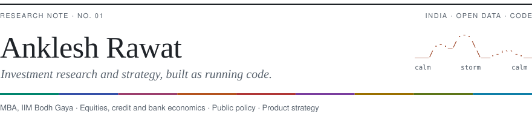

<picture>
  <source media="(prefers-color-scheme: dark)" srcset="assets/masthead-dark.svg">
  
</picture>

  <a href="mailto:anklesh.r@merinth.in"> Email</a> &nbsp;·&nbsp;
  <a href="https://www.linkedin.com/in/anklesh-rawat-00508a1aa/"> LinkedIn</a> &nbsp;·&nbsp;
  <a href="https://papers.ssrn.com/abstract=7135161"> SSRN</a> &nbsp;·&nbsp;
  <a href="https://orcid.org/0009-0001-2399-8032"> ORCID</a> &nbsp;·&nbsp;
  <a href="https://portfolio-five-rouge-90.vercel.app"> Portfolio</a>

Each case below ships as a repo with a Python pipeline, tests and a live site that GitHub Actions refreshes from public sources, including the ones where the answer came back no.

### 🏦 Banking and credit

| Project | What it found | |
| :-- | :-- | :-- |
| [HDFC Bank: the 2% question](https://github.com/DogInfantry/Bank-Profitability) | Back to a 2% RoA by FY29 only through six funding levers, and the share price already assumes it | [Live&nbsp;↗](https://site-two-eta-4o267upa77.vercel.app) |
| [Debt covenant surveillance](https://github.com/DogInfantry/dynamic-debt-covenant-surveillance-frame) | Covenant breach flags and cross-default cascades across 8 SEC filers | [Live&nbsp;↗](https://dynamic-debt-covenant-surveillance.vercel.app) |
| [India LBO take-private screener](https://github.com/DogInfantry/India-LBO-Take-Pv-Screener) | A paper LBO on every NSE mid-cap with unused debt capacity, under RBI's February 2026 rules | [Live&nbsp;↗](https://india-lbo-take-pv-screener.vercel.app) |
| [merger-lab](https://github.com/DogInfantry/merger-lab) | Accretion/dilution for Indian M&A. Two of three sample deals come back DECLINE | [Repo&nbsp;↗](https://github.com/DogInfantry/merger-lab) |

### 📈 Markets and quant research

| Project | What it found | |
| :-- | :-- | :-- |
| [Sellside research engine](https://github.com/DogInfantry/sellside-research-engine) | Reverse DCF, comps and factor ranks on 21 US names, refreshed every weekday | [Live&nbsp;↗](https://sellside-research-engine.vercel.app) |
| [Signals Before Storms](https://github.com/DogInfantry/Signals-Before-Storms) | The HMM found the regimes; the strategy did not beat a 60/40. Retraction published | [Live&nbsp;↗](https://signals-before-storms.vercel.app) · [Ledger&nbsp;↗](https://storm-ledger.vercel.app) |
| [ENSO macro risk desk](https://github.com/DogInfantry/El_Nino) | None of 7 El Niño to commodity-price links survives causal tests | [Live&nbsp;↗](https://doginfantry-enso-macro-risk-desk.hf.space) |
| [Capital markets intelligence](https://github.com/DogInfantry/capital-markets-intelligence) | IPO event studies, sovereign risk scoring and yield-curve decomposition on open data | [Live&nbsp;↗](https://capital-markets-intelligence.vercel.app) |

### 🧭 Strategy and policy: India

| Project | What it found | |
| :-- | :-- | :-- |
| [India Wide-Body Window](https://github.com/DogInfantry/india-widebody-window) | Europe first, North America second. The recommendation reversed midway, and the case records why | [Live&nbsp;↗](https://india-widebody-window.vercel.app) |
| [India FS Pulse](https://github.com/DogInfantry/india-fs-pulse) | Merchant UPI payments are 63.9% of transactions but 23% of value, and earn no fee | [Live&nbsp;↗](https://india-fs-pulse.vercel.app) |
| [Ground Truth: data centres](https://github.com/DogInfantry/datacentre-announced-vs-delivered) | About 619 MW is live of the 10.6 GW announced, read from filings | [Live&nbsp;↗](https://datacenter-capacity-audit.vercel.app) |
| [Sustainable finance transition](https://github.com/DogInfantry/sustainable-finance-india-transition) | Green bonds, SEBI and RBI frameworks, and transition finance for hard-to-abate sectors | [Live&nbsp;↗](https://sustainable-finance-india-transitio.vercel.app) |

### 🤖 AI workflows

- **[Consulting skill for Claude](https://github.com/DogInfantry/claude-skill-management-consultant-B1)** ★ 158. One `SKILL.md` that gives an LLM a consultant's structure (hypothesis first, MECE, pyramid principle), packaged for Claude, Codex, Gemini, Copilot and Ollama.
- **How the repos above are built.** Mostly agent-assisted, with a `CLAUDE.md` in the repo setting the rules the coding agent works to, and GitHub Actions that refresh the data and check it before anything publishes.

### 📄 Papers and research notes

- [Regulating the Retail Options Boom](https://papers.ssrn.com/abstract=7135161). SSRN working paper on what SEBI's 2024–25 index-derivatives curbs did to retail participation.
- [Awareness Without Uptake](https://papers.ssrn.com/abstract=7239538). SSRN working paper on why rural households who know about a benefit still do not receive it.
- [Bharti Airtel: initiation of coverage](https://portfolio-five-rouge-90.vercel.app/research/bharti-airtel-initiation). Sum-of-the-parts valuation, HOLD, with the event that would change the rating set out in advance.

### 🛠 Toolkit

   &nbsp;
   &nbsp;
   &nbsp;
   &nbsp;
   &nbsp;
   &nbsp;
   &nbsp;
   &nbsp;
   &nbsp;
   &nbsp;
  
   
  Python · pandas · DuckDB · TypeScript · Next.js · Svelte · GitHub Actions · Vercel · Hugging Face · Docker · Claude

**Analysis** &nbsp; DCF and reverse DCF, LBO, comparables, bank P&L, market sizing, difference-in-differences, Granger and CCM

**Upstream fixes merged** &nbsp; [yfinance](https://github.com/ranaroussi/yfinance/pull/2891) · [plotly.py](https://github.com/plotly/plotly.py/pull/5669) · [Grafana](https://github.com/grafana/grafana/pull/128190) · [dexter](https://github.com/virattt/dexter/pull/281) · [stockstats](https://github.com/jealous/stockstats/pull/205) · [Bigcapital](https://github.com/bigcapitalhq/bigcapital/pull/1135)

<b>Recently pushed</b>

<!-- recent:start -->
- [Bank-Profitability](https://github.com/DogInfantry/Bank-Profitability) · HDFC Bank: the path back to 2% RoA · 2026-11-04
- [Signals-Before-Storms](https://github.com/DogInfantry/Signals-Before-Storms) · I built a Hidden Markov Model to find market regimes and allocate on them · 2026-11-04
- [sellside-research-engine](https://github.com/DogInfantry/sellside-research-engine) · Equity research dashboard and Python pipeline: DCF, reverse DCF, comps, factor screening and risk… · 2026-11-04
- [portfolio](https://github.com/DogInfantry/portfolio) · Portfolio - Strategy, Investment Research & Quantitative Tools · 2026-11-02
- [El_Nino](https://github.com/DogInfantry/El_Nino) · ENSO Macro Risk Desk - A Bloomberg-style terminal mapping El Niño/La Niña to commodity & sector… · 2026-10-06
<!-- recent:end -->

---

[Portfolio](https://portfolio-five-rouge-90.vercel.app) &nbsp;·&nbsp; [LinkedIn](https://www.linkedin.com/in/anklesh-rawat-00508a1aa/) &nbsp;·&nbsp; [SSRN](https://papers.ssrn.com/abstract=7135161) &nbsp;·&nbsp; [ORCID](https://orcid.org/0009-0001-2399-8032) &nbsp;·&nbsp; [anklesh.r@merinth.in](mailto:anklesh.r@merinth.in)
